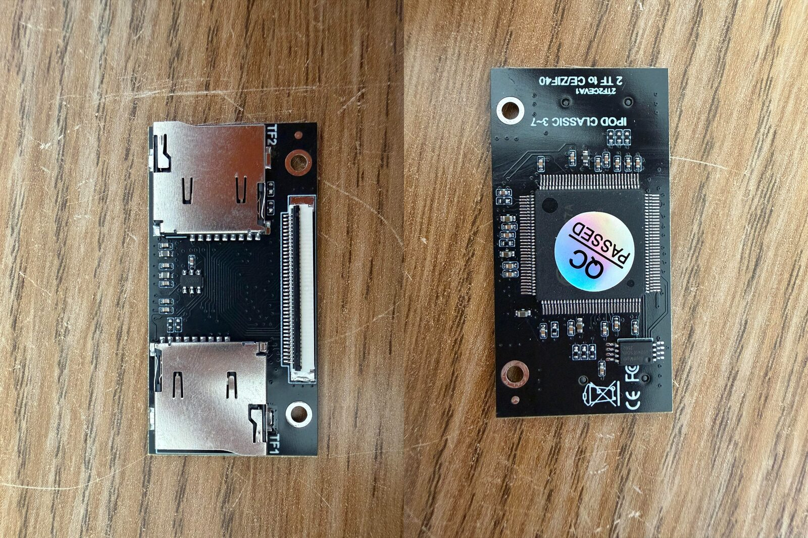

# FC1307A Dual SD Card Adapter

Open-hardware reverse engineering of the iPod dual SD card adapter built around the **FC1307A** controller — schematics, PCB design and Gerbers, free to use and adapt for your own projects.(under making)

  
   
  <em>Source adapter (front &amp; back), sourced from AliExpress</em>

---

## Project status

- [x] Schematics based on the reference Reddit post
- [ ] Correction and revision of the initial schematics against the real hardware
- [ ] PCB design in KiCad
- [ ] Assembly and testing with iPod Classic 5th gen and 7th gen
- [ ] Final release of Gerber files
